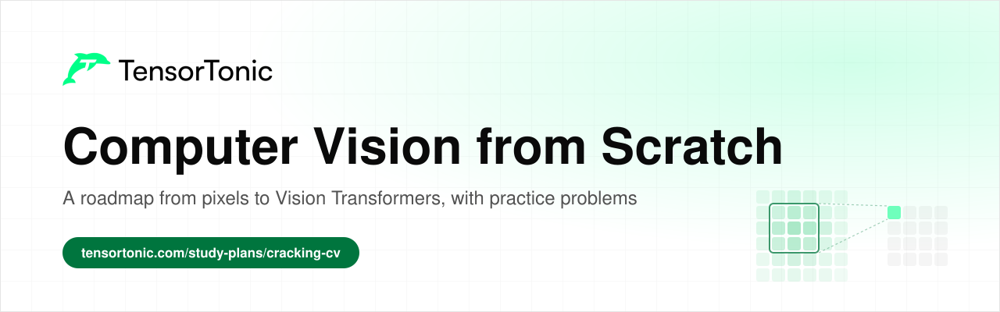
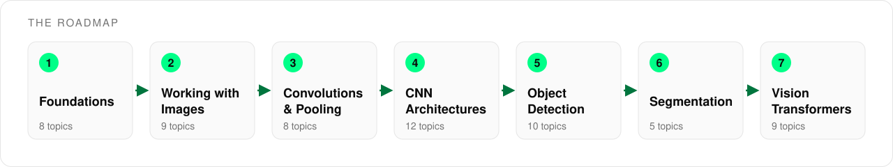

# Computer Vision from Scratch

  

This is a roadmap for learning computer vision by building each piece yourself, from basic image operations up to Vision Transformers and CLIP. It covers 61 topics across seven stages, in the order a learner usually needs them.

Every topic links to an explanation where one exists and to practice problems where you implement the idea in Python and check your code against tests. Most of the problems come from the [Cracking CV](https://www.tensortonic.com/study-plans/cracking-cv) study plan, and the rest fill in the math and deep learning it assumes.

## Table of Contents

- [Who this is for](#who-this-is-for)
- [How to use this roadmap](#how-to-use-this-roadmap)
- [Stage 1: Foundations](#stage-1-foundations)
- [Stage 2: Working with Images](#stage-2-working-with-images)
- [Stage 3: Convolutions and Pooling](#stage-3-convolutions-and-pooling)
- [Stage 4: CNN Architectures](#stage-4-cnn-architectures)
- [Stage 5: Object Detection](#stage-5-object-detection)
- [Stage 6: Segmentation](#stage-6-segmentation)
- [Stage 7: Vision Transformers and CLIP](#stage-7-vision-transformers-and-clip)
- [What's next](#whats-next)
- [License](#license)

## Who this is for

This roadmap is for anyone who wants to understand how vision models work by writing their parts instead of only calling a library.

- If you are a **student**, go through the stages in order and solve at least one problem per topic.
- If you are **preparing for interviews**, the convolution, detection and ViT stages cover the operations most often asked about in computer vision rounds.
- If you already **work in ML**, use the tables as a checklist and pick the topics you have never implemented yourself.

You need basic Python and NumPy. You do not need a GPU, since every problem runs on small arrays.

## How to use this roadmap

Each stage builds on the ones before it. Convolutions are matrix operations on image arrays, CNN architectures stack convolutions, and detection, segmentation and Vision Transformers all reuse those building blocks.

For each topic, read the explanation first if there is one, then solve one or two of the practice problems. Topics without a Read link are covered well enough by the problem statement itself.

## Stage 1: Foundations

An image is an array of numbers and a layer is a matrix operation, so the linear algebra and calculus behind neural networks come first. Skip any topic you already know well.

| Topic | Read | Practice |
| --- | --- | --- |
| Vectors and dot products | [What is the dot product?](https://www.tensortonic.com/ml-math/linear-algebra/dot-norm) | [Dot Product](https://www.tensortonic.com/problems/dot-product), [Cosine Similarity](https://www.tensortonic.com/problems/cosine-similarity) |
| Matrix multiplication | [How matmul works](https://www.tensortonic.com/ml-math/linear-algebra/matrix-multiplication) | [Matrix Multiply](https://www.tensortonic.com/problems/la-matrix-multiply), [Matrix Transpose](https://www.tensortonic.com/problems/matrix-transpose) |
| PCA and whitening | [What is PCA?](https://www.tensortonic.com/ml-math/linear-algebra/pca) | [PCA Projection onto Principal Components](https://www.tensortonic.com/problems/pca-projection), [Whitening Transform](https://www.tensortonic.com/problems/la-whitening) |
| SVD and low-rank approximation | [What is SVD?](https://www.tensortonic.com/ml-math/linear-algebra/svd) | [Low-Rank Approximation](https://www.tensortonic.com/problems/la-low-rank-approx) |
| Backpropagation | [How backpropagation works](https://www.tensortonic.com/ml-math/calculus/backpropagation), [What is the chain rule?](https://www.tensortonic.com/ml-math/calculus/chain-rule) | [Backpropagation (Single Hidden Layer)](https://www.tensortonic.com/problems/dl-backpropagation) |
| Softmax and cross-entropy | [Which Loss Function to Use, and Why](https://www.tensortonic.com/guides/which-loss-function-to-use) | [Numerically Stable Softmax](https://www.tensortonic.com/problems/softmax-function), [Cross-Entropy Loss](https://www.tensortonic.com/problems/cross-entropy-loss) |
| Optimizers | [Adam vs RMSprop vs AdaGrad](https://www.tensortonic.com/ml-math/optimization/adaptive-rates) | [Adam Optimizer Step](https://www.tensortonic.com/problems/adam-optimizer), [Gradient Clipping (Global Norm)](https://www.tensortonic.com/problems/gradient-clipping) |
| NumPy arrays | [NumPy study plan](https://www.tensortonic.com/study-plans/numpy-basics) | [Reshaping Arrays](https://www.tensortonic.com/problems/numpy-reshape), [Boolean Masking](https://www.tensortonic.com/problems/numpy-boolean-masking) |

## Stage 2: Working with Images

Before a model sees a picture, the picture is converted, rescaled and cleaned up. These operations are also the core of classic computer vision, and they teach you to think of an image as a grid of pixel values.

| Topic | Read | Practice |
| --- | --- | --- |
| Grayscale conversion | [Cracking CV study plan](https://www.tensortonic.com/study-plans/cracking-cv) | [Color to Grayscale](https://www.tensortonic.com/problems/color-to-grayscale), [RGB to Grayscale](https://www.tensortonic.com/problems/cv-rgb-to-grayscale) |
| Normalization and channel statistics | | [Image Normalize](https://www.tensortonic.com/problems/cv-image-normalize), [Per-Channel Mean and Std](https://www.tensortonic.com/problems/cv-channel-statistics) |
| Padding and cropping | | [Zero Pad and Center Crop](https://www.tensortonic.com/problems/cv-zero-pad-and-center-crop) |
| Resizing | | [Bilinear Interpolation](https://www.tensortonic.com/problems/bilinear-interpolation), [Bilinear Resize](https://www.tensortonic.com/problems/cv-bilinear-resize) |
| Rotation | | [Image Rotation (Nearest Neighbor)](https://www.tensortonic.com/problems/image-rotation-nearest) |
| Histograms | | [Image Histogram](https://www.tensortonic.com/problems/image-histogram), [Histogram Equalization](https://www.tensortonic.com/problems/histogram-equalization) |
| Gaussian blur | | [Gaussian Blur Kernel](https://www.tensortonic.com/problems/gaussian-blur-kernel), [Gaussian Blur 2D](https://www.tensortonic.com/problems/cv-gaussian-blur) |
| Edge detection | | [Sobel Edge Detection](https://www.tensortonic.com/problems/sobel-edge-detection) |
| Morphological operations | | [Morphological Erosion and Dilation](https://www.tensortonic.com/problems/morphological-operations) |

## Stage 3: Convolutions and Pooling

A convolution slides a small kernel over the image and computes a weighted sum at each position. Because the same weights are reused everywhere, a pattern is detected wherever it appears, and pooling then shrinks the result to keep the strongest responses.

| Topic | Read | Practice |
| --- | --- | --- |
| 2D convolution | [AlexNet convolution layers](https://www.tensortonic.com/research/alexnet/alexnet-conv-layers) | [2D Convolution (Image Filtering)](https://www.tensortonic.com/problems/conv2d-image-filtering), [2D Convolution from Scratch](https://www.tensortonic.com/problems/dl-convolution-operation) |
| Multichannel convolution | | [Simple CNN Layer (NumPy)](https://www.tensortonic.com/problems/simple-cnn-layer), [Multichannel 2D Convolution](https://www.tensortonic.com/problems/cv-conv2d-multichannel) |
| Max pooling | [AlexNet pooling](https://www.tensortonic.com/research/alexnet/alexnet-pooling), [VGG max pooling](https://www.tensortonic.com/research/vgg/vgg-maxpool) | [2D Max Pooling](https://www.tensortonic.com/problems/maxpool-forward), [Max Pool 2D](https://www.tensortonic.com/problems/cv-max-pool-2d) |
| Average and global pooling | | [Average Pooling 2D](https://www.tensortonic.com/problems/average-pooling-2d), [Global Average Pooling](https://www.tensortonic.com/problems/global-avg-pooling) |
| Adaptive pooling | | [Adaptive Average Pool 2D](https://www.tensortonic.com/problems/cv-adaptive-avg-pool-2d) |
| Dilated convolution | | [Dilated 2D Convolution](https://www.tensortonic.com/problems/cv-dilated-conv2d) |
| Depthwise separable convolution | | [Depthwise Separable Convolution](https://www.tensortonic.com/problems/cv-depthwise-separable-conv) |
| Transposed convolution | | [2D Transposed Convolution](https://www.tensortonic.com/problems/cv-conv2d-transpose), [Transposed Convolution](https://www.tensortonic.com/problems/dl-transposed-convolution) |

## Stage 4: CNN Architectures

Stacking convolutions, normalization and activations lets early layers find edges and later layers find whole objects. This stage covers what makes deep networks train at all, then rebuilds the classic architectures, including the residual connection that made very deep networks practical.

| Topic | Read | Practice |
| --- | --- | --- |
| Activation functions | [AlexNet ReLU](https://www.tensortonic.com/research/alexnet/alexnet-relu) | [Activation Functions](https://www.tensortonic.com/problems/dl-activation-functions) |
| Dropout | [AlexNet dropout](https://www.tensortonic.com/research/alexnet/alexnet-dropout) | [Dropout (Training Mode)](https://www.tensortonic.com/problems/dropout-training) |
| Weight initialization | | [He Initialization](https://www.tensortonic.com/problems/he-initialization), [Xavier Initialization](https://www.tensortonic.com/problems/xavier-initialization) |
| Batch normalization | [What is batch norm?](https://www.tensortonic.com/ml-math/optimization/batch-normalization), [ResNet batch norm](https://www.tensortonic.com/research/resnet/resnet-batch-norm) | [Batch Normalization (Forward)](https://www.tensortonic.com/problems/batch-normalization) |
| Data augmentation | [AlexNet data augmentation](https://www.tensortonic.com/research/alexnet/alexnet-augmentation) | [MixUp Augmentation](https://www.tensortonic.com/problems/cv-mixup), [CutMix Augmentation](https://www.tensortonic.com/problems/cv-cutmix) |
| LeNet | | [LeNet Forward Pass](https://www.tensortonic.com/problems/dl-lenet-5) |
| VGG | [VGG convolution block](https://www.tensortonic.com/research/vgg/vgg-conv-block), [VGG full network](https://www.tensortonic.com/research/vgg/vgg-full-network) | [VGG Convolution Block](https://www.tensortonic.com/problems/dl-vgg-block) |
| Inception | | [Inception Module](https://www.tensortonic.com/problems/dl-inception-module) |
| ResNet | [ResNet skip connection](https://www.tensortonic.com/research/resnet/resnet-skip-connection), [ResNet bottleneck](https://www.tensortonic.com/research/resnet/resnet-bottleneck) | [ResNet Residual Block](https://www.tensortonic.com/problems/dl-resnet-block) |
| DenseNet | [DenseNet dense block](https://www.tensortonic.com/research/densenet/densenet-dense-block), [DenseNet transition layer](https://www.tensortonic.com/research/densenet/densenet-transition) | |
| Squeeze-and-excitation | | [Squeeze-and-Excitation Block](https://www.tensortonic.com/problems/dl-squeeze-excitation) |
| Classification metrics | [Machine Learning Evaluation Metrics](https://www.tensortonic.com/guides/ml-evaluation-metrics) | [Top-K Classification Accuracy](https://www.tensortonic.com/problems/cv-topk-accuracy), [Compute Accuracy, Precision, Recall, F1](https://www.tensortonic.com/problems/classification-metrics) |

## Stage 5: Object Detection

A detector predicts many candidate boxes and then cleans them up. IoU measures how much two boxes overlap, anchors give the network preset shapes to adjust, and non-maximum suppression removes duplicates before the results are scored with mean average precision.

| Topic | Read | Practice |
| --- | --- | --- |
| Intersection over union | [Computer Vision projects](https://www.tensortonic.com/projects/sheets/computer-vision) | [Intersection over Union (IoU)](https://www.tensortonic.com/problems/iou-bounding-box), [Pairwise IoU](https://www.tensortonic.com/problems/cv-iou-pairwise) |
| Anchor boxes | | [Anchor Box Generation](https://www.tensortonic.com/problems/anchor-box-generation) |
| Box encoding | | [Box Encode and Decode](https://www.tensortonic.com/problems/cv-box-encode-decode) |
| Non-maximum suppression | | [Non-Maximum Suppression](https://www.tensortonic.com/problems/non-maximum-suppression), [Soft Non-Maximum Suppression](https://www.tensortonic.com/problems/cv-soft-nms) |
| ROI pooling and ROI Align | | [ROI Pooling](https://www.tensortonic.com/problems/roi-pooling), [ROI Align](https://www.tensortonic.com/problems/cv-roi-align) |
| Feature pyramids | | [FPN Top-Down Fusion](https://www.tensortonic.com/problems/cv-fpn-fusion) |
| Hungarian matching | | [Hungarian Matching](https://www.tensortonic.com/problems/cv-hungarian-matching) |
| Focal loss | [Which Loss Function to Use, and Why](https://www.tensortonic.com/guides/which-loss-function-to-use) | [Focal Loss](https://www.tensortonic.com/problems/focal-loss), [Sigmoid Focal Loss](https://www.tensortonic.com/problems/cv-focal-loss) |
| IoU-based box losses | | [Generalized IoU Loss](https://www.tensortonic.com/problems/cv-giou-loss), [Complete IoU Loss](https://www.tensortonic.com/problems/cv-ciou-loss) |
| Mean average precision | [Machine Learning Evaluation Metrics](https://www.tensortonic.com/guides/ml-evaluation-metrics) | [Compute Mean Average Precision (mAP)](https://www.tensortonic.com/problems/mean-average-precision) |

## Stage 6: Segmentation

Segmentation assigns a label to every pixel. U-Net does this with an encoder that shrinks the image, a decoder that grows it back, and skip connections that carry fine detail across, and the losses and metrics compare predicted masks with true ones.

| Topic | Read | Practice |
| --- | --- | --- |
| Encoder and decoder blocks | [U-Net encoder block](https://www.tensortonic.com/research/unet/unet-encoder-block), [U-Net decoder block](https://www.tensortonic.com/research/unet/unet-decoder-block) | [Tiny U-Net Forward Pass](https://www.tensortonic.com/problems/diffusion-l03-tiny-unet-forward) |
| Skip connections | [U-Net skip connection](https://www.tensortonic.com/research/unet/unet-skip-connection) | [U-Net Skip Connection](https://www.tensortonic.com/problems/dl-unet) |
| Full U-Net | [U-Net bottleneck](https://www.tensortonic.com/research/unet/unet-bottleneck), [U-Net full network](https://www.tensortonic.com/research/unet/unet-full-network) | |
| Dice loss | | [Dice Loss](https://www.tensortonic.com/problems/dice-loss) |
| Mean IoU | | [Mean IoU for Segmentation](https://www.tensortonic.com/problems/cv-miou) |

## Stage 7: Vision Transformers and CLIP

A Vision Transformer cuts an image into patches, treats each patch as a token and runs a standard Transformer over them. CLIP then trains an image encoder and a text encoder together so that matching image and caption pairs end up close in the same embedding space.

| Topic | Read | Practice |
| --- | --- | --- |
| Attention | [The attention mechanism](https://www.tensortonic.com/llm-internals/attention-mechanism) | [Scaled Dot-Product Attention in Python](https://www.tensortonic.com/problems/dl-scaled-dot-product-attention), [Multi-Head Attention](https://www.tensortonic.com/problems/dl-multi-head-attention) |
| Layer normalization | | [Layer Normalization](https://www.tensortonic.com/problems/dl-layer-normalization) |
| Patch embedding | [ViT patch embedding](https://www.tensortonic.com/research/vit/vit-patch-embedding) | [Patchify a Batch of Images](https://www.tensortonic.com/problems/cs336-l17-vision-transformer-patchify), [ViT Patchify](https://www.tensortonic.com/problems/cv-patchify) |
| Position embeddings | [ViT position embedding](https://www.tensortonic.com/research/vit/vit-position-embedding), [RoPE: Rotary Position Embedding Explained](https://www.tensortonic.com/llm-internals/rope) | [Sinusoidal Positional Encoding](https://www.tensortonic.com/problems/positional-encoding), [2D Sinusoidal Positional Embedding](https://www.tensortonic.com/problems/cv-2d-sincos-pos-embed) |
| Class token and classification head | [ViT class token](https://www.tensortonic.com/research/vit/vit-class-token), [ViT MLP head](https://www.tensortonic.com/research/vit/vit-mlp-head) | |
| Encoder block | [ViT encoder block](https://www.tensortonic.com/research/vit/vit-encoder-block), [ViT full network](https://www.tensortonic.com/research/vit/vit-full-network) | [ViT Multi-Head Self-Attention](https://www.tensortonic.com/problems/cv-vit-attention-block) |
| Windowed attention | | [Window Partition and Reverse](https://www.tensortonic.com/problems/cv-window-partition) |
| CLIP | [Train a Tiny CLIP from Scratch](https://www.tensortonic.com/projects/tiny-clip-from-scratch) | [Symmetric CLIP Contrastive Loss](https://www.tensortonic.com/problems/cs336-l17-symmetric-clip-loss), [CLIP Cosine Retrieval](https://www.tensortonic.com/problems/cv-clip-cosine-retrieval) |
| Contrastive losses | | [SigLIP Pairwise Loss](https://www.tensortonic.com/problems/cs336-l17-siglip-pairwise-loss), [InfoNCE Loss](https://www.tensortonic.com/problems/info-nce-loss) |

## What's next

Once these pieces feel familiar, work through the full [Cracking CV](https://www.tensortonic.com/study-plans/cracking-cv) study plan and then build something larger from the [Computer Vision projects](https://www.tensortonic.com/projects/sheets/computer-vision) sheet. The [research](https://www.tensortonic.com/research) section rebuilds AlexNet, VGG, ResNet, DenseNet, U-Net and ViT step by step, and the [diffusion study plan](https://www.tensortonic.com/study-plans/diffusion-from-scratch) is a good next track if you want to generate images instead of classifying them.

If you are preparing for interviews, the [Computer Vision Interview Questions](https://www.tensortonic.com/guides/computer-vision-interview-questions) guide covers the vision questions that come up most, from detection and segmentation to ViT and CLIP.

For a written plan of what to learn and in which order, the [How to Learn Computer Vision](https://www.tensortonic.com/guides/how-to-learn-computer-vision) guide lays out a path through the field from the basics to current models.

## License

MIT
